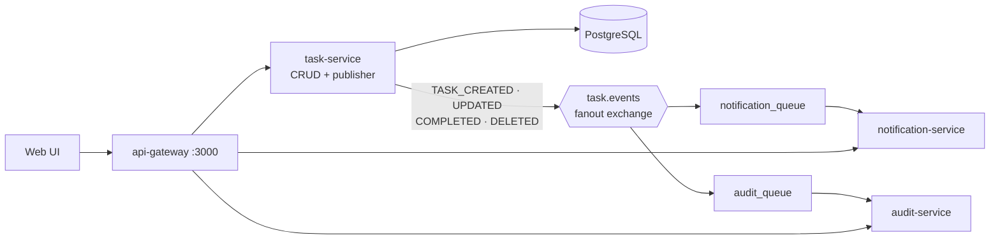

# Event-Driven Task Board with RabbitMQ

**When a task changes, the task service publishes an event once, and independent consumers react to it: a notification service and an audit service. Neither consumer knows the other exists, so new features can be added without touching the task service.**


> **ENGSE207 Software Architecture, Week 7 lab.** This is part of a series that evolves one task board through different architectures: [layered](https://github.com/tawan230666/engse207-week4-layered) → [N-tier](https://github.com/tawan230666/engse207-task-board) → [load-balanced with Redis](https://github.com/tawan230666/Week6_lab_ntier_redis_loadbalance) → **event-driven** → [secured microservices](https://github.com/tawan230666/engse207-termproject-jwt-microservices).

## Architecture



## How it works

- **Event contract.** `shared/events/eventTypes.js` is the single source of truth for event names, the exchange and queue names, and the event envelope (`id`, `type`, `data`, `metadata.timestamp/source/version`).
- **Fanout exchange.** The publisher doesn't know who is listening. Each consumer binds its own durable queue, so adding a third consumer (for example, analytics) needs no change to the task service.
- **Reliability.** The exchange and queues are durable and messages are persistent, so they survive a broker restart. Consumers `ack` only after successful processing, and malformed messages are `nack`ed without requeue to avoid poison-message loops.
- **Startup resilience.** Every service retries the RabbitMQ connection (10 attempts, 3 s apart) while the broker boots.

## Run it

```bash
git clone https://github.com/tawan230666/week7_lab_event_driven_rabbitmq.git
cd week7_lab_event_driven_rabbitmq
docker compose up -d --build
docker compose logs -f task-service notification-service audit-service
```

| URL | What |
|---|---|
| http://localhost:3000 | Task board UI (via the gateway) |
| http://localhost:15672 | RabbitMQ management UI (`guest` / `guest`) |

Create or complete a task in the UI, then watch the event fan out to both consumers in the logs:

```bash
curl -X POST http://localhost:3000/api/tasks -H "Content-Type: application/json" \
  -d '{"title":"Write release notes","priority":"high"}'
curl http://localhost:3000/api/notifications   # created by notification-service
curl http://localhost:3000/api/audit           # recorded by audit-service
```

## Project structure

```
api-gateway/            Single entry point: proxies /api/tasks, /api/notifications, /api/audit
task-service/           Layered CRUD service (routes → controller → service → repository) + publisher
notification-service/   Consumer: turns events into user notifications
audit-service/          Consumer: keeps an audit trail of every change
shared/events/          Event contract and RabbitMQ connection helper
database/init.sql       Schema and seed data
```

## Limitations and next steps

- Notifications and the audit trail are kept in memory; persisting them would make the consumers restart-safe.
- Add a dead-letter queue for rejected messages instead of dropping them.
- Publish events using the transactional outbox pattern, so a database write and its event can't diverge.

---

**Author:** Tawan Tiphkun ([@tawan230666](https://github.com/tawan230666)), Software Engineering, RMUTL Chiang Mai
